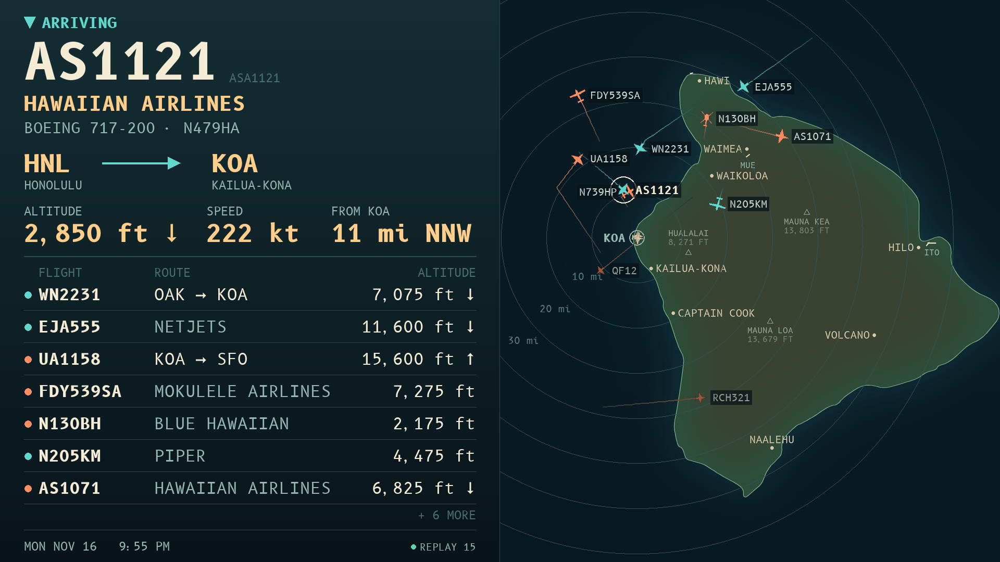

# Kona Flight Tracker

A wall display of the sky around Kailua-Kona International (KOA). One Python
process, pygame, 1920×1080, built to run unattended on a **Raspberry Pi Zero
2 W** (512 MB RAM).



- **Left:** the featured flight (the nearest real KOA arrival or departure):
  flight number, airline, aircraft, route, altitude, speed, distance from KOA.
  Below it, a table of everything else in range, and a status strip.
- **Right:** the Big Island with live aircraft. Three colours, on the map and
  in the text: **sand = on the ground, teal = toward Kona, coral = leaving
  Kona.** High overflights use the same colours, smaller and dimmer.

The rule the whole thing is built around: **never show wrong data; blank beats
wrong.** A route that doesn't fit what the aircraft is doing is not shown. An
altitude is never negative. An aircraft that hasn't been heard from in 30
seconds disappears instead of freezing in place.

---

## Day to day

Everything below marked **Pi** is typed over SSH. From Windows PowerShell:

```powershell
ssh colleran@kona-tracker.local
```

| I want to... | Pi command |
|---|---|
| update to the newest code | `~/flight-tracker/tools/update.sh` |
| check that everything works | `python3 ~/flight-tracker/app.py --selftest` |
| see what it would show, as text | `python3 ~/flight-tracker/app.py --once` |
| watch the log | `journalctl -t kona-flight-tracker -f` |
| restart the display | `pkill -HUP -f 'python3 .*app\.py'` |
| stop the display | `pkill -TERM -f 'python3 .*app\.py'` |
| change a setting | `nano ~/flight-tracker/config.local.toml`, then restart |

`update.sh` pulls the branch the Pi is on, runs the tests and the self-test,
and only then restarts the display. If a check fails it puts the code back the
way it was and leaves the running display alone.

### Changing settings

`config.toml` holds every setting, with comments. Don't edit it on the Pi:
put only the keys you want to change in `config.local.toml` next to it. That
file is ignored by git, so updates never conflict with it.

```toml
# ~/flight-tracker/config.local.toml
[display]
clock_24h = false        # 4:38 PM instead of 16:38
max_rows = 6

[map]
icon_shapes = true       # helicopters and light props get their own silhouettes
```

A typo gives a one-line message naming the section and key; the launcher keeps
retrying, so fixing the file is enough.

---

## First-time setup on the Pi

The Pi runs Raspberry Pi OS (Trixie) with the desktop (labwc), user `colleran`,
hostname `kona-tracker`.

**Pi:**

```bash
sudo apt update
sudo apt install -y git python3-pygame python3-pytest
sudo timedatectl set-timezone Pacific/Honolulu
```

If an older copy is already there (the zip-and-scp deploy), move it aside
first:

```bash
mv ~/flight-tracker ~/flight-tracker-backup-$(date +%Y%m%d)
```

Get the code and set up the launcher:

```bash
git clone https://github.com/jcolleran1/kona-flight-tracker.git ~/flight-tracker
~/flight-tracker/tools/install.sh
python3 ~/flight-tracker/app.py --selftest
sudo reboot
```

To run a branch other than the default (for example to try `fable` before it is
merged), add `-b fable` to the `git clone` line, or later:
`cd ~/flight-tracker && git switch fable && tools/update.sh`.

If `git clone` asks for a username, the repository is private. Either make it
public or add a read-only deploy key for the Pi (GitHub: repository Settings →
Deploy keys). Never put a token in a file in this repo.

### What `install.sh` does

There is exactly one way the display starts: `tools/run.sh`, launched from
`~/.config/labwc/autostart`. `install.sh` adds that one line and comments out
any older line that started `app.py` directly, in both the labwc and the
lxsession autostart files (each changed file gets a `.bak` copy). It is safe
to run again.

`run.sh` runs the app inside the desktop session, sends its output to the
system journal (no log files on the SD card), and restarts it if it exits
unexpectedly, waiting longer each time if it keeps crashing. A second copy of
the app refuses to start (a lock in `$XDG_RUNTIME_DIR`), so the screen can
never have two instances fighting over it.

### Keep the screen on, protect the SD card

```bash
# never blank: append to the single line in this file, then reboot
sudo nano /boot/firmware/cmdline.txt        # add:  consoleblank=0

# cap the journal
sudo nano /etc/systemd/journald.conf        # SystemMaxUse=30M
sudo systemctl restart systemd-journald
```

---

## Where the data comes from

| What | Source | Limits and terms we follow |
|---|---|---|
| Aircraft positions | [airplanes.live](https://airplanes.live/api-guide/) | 1 request/second, non-commercial. Polled every 5 s. |
| Aircraft positions | [adsb.fi](https://adsb.fi/) ([open data terms](https://github.com/adsbfi/opendata)) | 1 request/second, personal non-commercial use, must be cited. Polled every 5 s. |
| Aircraft positions (optional, off) | [adsb.lol](https://adsb.lol/) | Dynamic limits; an API key is planned. Polled every 10 s when enabled. |
| Aircraft positions (optional, off) | your own receiver | See below. |
| Routes, airframes | [adsbdb.com](https://www.adsbdb.com/) | At most one request every 2 s, cached for hours. |
| Altimeter setting | [aviationweather.gov](https://aviationweather.gov/data/api/) METAR for PHKO | One request every 30 minutes. |
| Airline names | [OpenFlights](https://openflights.org/data.php) (ODbL), plus `data/overrides.csv` | Bundled. |
| Coastline | [Natural Earth](https://www.naturalearthdata.com/) 1:10m | Public domain. Bundled, baked into the map image. |
| Runways | [OurAirports](https://ourairports.com/data/) | Public domain. |
| Font | B612 Mono | SIL Open Font License (`data/OFL-B612Mono.txt`). |

No API keys are used anywhere, and none belong in this repository. All
position sources are merged: for each aircraft the freshest position wins, so
the display sees more than any single feed. A source that fails or refuses a
request is left alone for a while (15 minutes after an HTTP 403) and the others
carry on. The status strip shows a dot, a name and an aircraft count for each
source.

Which sources are polled is `[fetch] sources` in the config. Before enabling
another one, check it answers from the Pi's network:
`python3 app.py --selftest` lists every source it knows, enabled or not.

### Why the numbers differ from FlightRadar24 sometimes

- **Altitude.** Aircraft broadcast *pressure* altitude, which reads about
  −100 ft on the runway at Kona on a normal high-pressure day. Below 18,000 ft
  the display corrects it with the airport's current altimeter setting, the
  same correction a pilot makes. It should agree with FR24's calibrated
  altitude within a couple of hundred feet.
- **Flight numbers** are shown the way airport boards show them (`UA1759`),
  translated from the callsign the aircraft broadcasts (`UAL1759`), which is
  printed small next to it. Callsigns that aren't a flight number (`FDY539SA`,
  tail numbers) are shown unchanged.
- **Hawaiian flights** broadcast Alaska callsigns (`ASA1121`) now that the two
  airlines operate together. The display shows the `AS` flight number and
  names the airline **Hawaiian** when the aircraft is one of Hawaiian's
  (`data/brand_rules.csv`).
- **Coverage.** These feeds rely on volunteer receivers and the Big Island has
  few. FR24 has more receivers plus satellite and estimated positions, so it
  will sometimes show an aircraft this display can't see, especially low near
  the airport. Merging feeds narrows the gap; a receiver at the house closes
  most of it.

Fixing a wrong airline name: add or correct a row in `data/overrides.csv`
(`icao,iata,name`). A row with a blank name tells the display to print nothing
for that prefix.

---

## Adding a receiver at the house (optional)

A USB software radio hears every ADS-B aircraft in line of sight directly,
with no internet delay. The code for it is already here and tested; it is
switched off until the hardware exists.

**Parts**

- RTL-SDR dongle made for 1090 MHz (an RTL-SDR Blog V3/V4 or a FlightAware Pro
  Stick) and a 1090 MHz antenna, placed by a window facing the airport or,
  better, outdoors.
- For the Zero 2 W: a micro-USB OTG adapter and a **powered** USB hub. The
  Zero's port can't reliably power a dongle.

**Software (Pi):** install `readsb` (the decoder most of these networks use).
Its maintainer publishes an installer at
<https://github.com/wiedehopf/adsb-scripts/wiki/Automatic-installation-for-readsb>;
read the script before running it. When it is running, this should print JSON:

```bash
curl -s http://127.0.0.1:8080/data/aircraft.json | head -c 300
```

**Turn it on** in `config.local.toml`:

```toml
[fetch]
sources = ["local", "airplanes_live", "adsb_fi"]

[local_receiver]
url = "http://127.0.0.1:8080/data/aircraft.json"   # or http://other-pi.local:8080/...
```

The receiver's positions win while they are fresh; registrations, types and
routes still come from the network feeds and adsbdb.

**Will the Zero 2 W cope with both?** Not measured yet: that needs the
hardware. After a busy hour with both running, check:

```bash
free -m                                   # "available" should stay above ~100 MB
ps -o rss,pcpu,comm -C readsb,python3     # memory (KB) and CPU of each
journalctl -t kona-flight-tracker | grep memory | tail -3
```

If available memory drops under about 100 MB, or the display stutters, run the
receiver on a second device (any Pi) and point `[local_receiver] url` at it.
That is the lighter setup either way.

---

## Working on it without the Pi

On a laptop (Windows PowerShell, macOS or Linux), with Python 3.11+:

```bash
pip install pygame pytest pillow      # pillow is only needed to re-bake the map
python -m pytest -q                   # the whole test suite, no network needed
python tools/preview.py               # previews/preview-00/01/05/15.png, headless
```

To run the live display in a window against the bundled recording, create
`config.local.toml` (never change `sources` to replay in `config.toml` itself):

```toml
[fetch]
sources = ["replay"]
replay_speed = 4.0

[display]
fullscreen = false
```

then `python app.py` (Esc or Q quits). The bundled recording
(`data/fixtures/kona_scenario.jsonl.gz`, made by `tools/make_scenario.py`) is a
scripted 15 minutes at Kona with every awkward case in it: an arrival that
rolls out with a negative pressure altitude, a Hawaiian 717 on an Alaska
callsign, a jet at 36,000 ft that must not be called an arrival, a route from
the database that is simply wrong.

To record real traffic for testing, on the Pi during a busy stretch:

```bash
python3 ~/flight-tracker/tools/record.py --minutes 90
```

Recordings land in `data/fixtures/live/` (git-ignored: the feeds' terms don't
allow redistributing their data) and play back with
`replay_file = "fixtures/live/<file>.jsonl.gz"`.

### Tools

| Tool | What it does |
|---|---|
| `tools/preview.py` | Renders preview PNGs through the real pipeline. `--night`, `--no-data`, `--icon-shapes`, `--count`, `--at`. |
| `tools/make_map.py` | Bakes `data/big_island_map.png` from the coastline data and the bounds in `config.toml`. `--fit 108` computes bounds with the right aspect ratio. `--land file.geojson` uses a more detailed coastline. |
| `tools/make_scenario.py` | Regenerates the bundled replay scenario. |
| `tools/make_airlines.py` | Regenerates `data/airlines.csv` from OpenFlights. |
| `tools/record.py` | Records raw feed responses on the Pi. |
| `tools/run.sh`, `install.sh`, `update.sh` | Launcher, one-time setup, one-command deploy (Pi). |

### Layout of the code

```
app.py                 entry point: --once, --selftest, --windowed; fetch supervisor
appliance.py           single-instance lock, memory watch, self-test
config.py / .toml      every setting, validated at startup; config.local.toml overlay
state.py               Aircraft, Snapshot; the one-way handoff from fetch to render

fetch/http.py          one HTTP helper: User-Agent, gzip, size cap, Retry-After
fetch/sources.py       airplanes.live, adsb.fi, adsb.lol, local receiver
fetch/replay.py        plays a recording in real time
fetch/merge.py         one record per aircraft from several sources
fetch/worker.py        the poll loop: staggered sources, backoff, publish

enrich/altitude.py     pressure altitude -> displayed altitude; ground detection
enrich/lookups.py      airline names, IATA flight numbers, brand rules, types
enrich/motion.py       arriving / departing / overflight / local; featured flight
enrich/routes.py       route validation
enrich/deadreckon.py   moving aircraft between position updates
enrich/tracker.py      per-aircraft memory; builds what the display shows
enrich/worker.py       background adsbdb and METAR lookups, bounded caches
enrich/metar.py        METAR parsing

render/renderer.py     main loop; repaints only what changed
render/panel.py        left panel
render/mapview.py      map panel
render/projection.py   lat/lon -> pixels
render/theme.py        palette, fonts, text cache
render/icons.py        aircraft silhouettes
render/units.py        number formatting
render/timeutil.py     clock, time zone, quiet hours

data/                  CSV lookups, fonts, map image, coastline, test fixtures
tests/                 pytest suite
tools/                 see the table above
```

Three threads: the main thread draws, the fetch thread polls and is the only
one that writes the shared snapshot, and the enrichment thread does the slow
lookups so they can never delay a position update.
